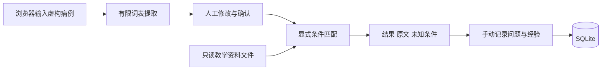

> 2026-10-12 整合更新：本文件保留教学原型的历史设计/验证。当前模块只提供内部 API，统一 React 页面为 `/tools/teaching/`（端口 50011）；正式资料与证据设计见根项目 [产品架构](../../../docs/product-architecture.md)。

# 技术方案

首版采用同源网页、FastAPI、只读教学资料文件和 SQLite 问题记录库。服务启动后即可断网演示；请求处理不会调用模型或外部网站。先验证完整流程，避免在样例阶段引入难以证明必要性的基础设施。

## 当前结构

前端是原生 HTML、CSS 和 JavaScript，一个页面承载三个视图；不需要前端构建或联网加载字体。后端区分输入契约、提取与匹配逻辑、存储三个职责。病例信息只存在于当前浏览器页面和单次请求内，刷新即清空；不会自动写入问题记录。

## 组件选择

| 组件 | 当前选择 | 原因与更换时机 |
| --- | --- | --- |
| 页面 | 原生 HTML CSS JavaScript | 单个轻量流程，无需引入复杂前端框架；页面复杂度显著增加再评估 |
| API | FastAPI Pydantic | 字段限制、明确契约和可生成的接口说明 |
| 资料 | 校验后的 JSON | 7 条教学记录直接读取，方便逐条审查 |
| 问题存储 | SQLite WAL | 单实例保存经验，参数化查询，事务提交与连接释放 |
| 部署 | Docker Compose | 单服务、明确端口、项目内 bind mount；保留 uv 原生启动方式 |
| 后续资料库 | PostgreSQL，必要时加 pgvector | 有实际数据规模、查询或多人需求后引入；普通字段仍保留结构化约束 |

FastAPI 官方提供容器部署指导；pgvector 是 PostgreSQL 的向量检索扩展。选择它们不代表当前版本已完成这些能力。[FastAPI 容器部署](https://fastapi.tiangolo.com/deployment/docker/)、[pgvector 项目文档](https://github.com/pgvector/pgvector)

## 匹配方法

当前严格匹配癌种，之后逐项核对分期、分子特征、城市。条目有条件但病例未提供时，保留未知；明确不一致时放入可展开的排除列表。药物的既往治疗过滤只比较分隔后的名称；没有同义词、联用关系、耐药推断和治疗线次推理。试验始终保留完整入排条件与实际招募状态待核对提示。

提取器只识别少量白名单表达，对含否定或不确定词的分句保守留空。它是可观察的流程占位实现，不是临床 NLP。后续接模型时保留同一个输入输出边界及人工确认，不让模型直接变更病例、发布资料或执行外部操作。

## 核心数据契约

| 对象 | 关键字段 |
| --- | --- |
| CaseFields | cancer、stage、biomarker、prior_therapy、city；空字符串表示未知 |
| Evidence | id、kind、适用字段、source_title、source_locator、source_version、source_text、updated_at、is_demo |
| SearchResult | run_id、status、results、excluded；每条含 matched、unknown、conflicts、match_state |
| Issue | id、title、category、observation、expected、lesson、run_id、status、created_at、updated_at |

`run_id` 只用于关联一次体验的问题，不保存查询快照或病例。历史查询不可复放是当前明确限制；后续如需复放，用预先核准的虚构场景 ID 或经批准的最小化数据解决。

## HTTP 接口

| 方法和路径 | 用途 |
| --- | --- |
| GET / | 工作台页面 |
| GET /api/health | 服务与演示模式状态 |
| POST /api/extract | 提取候选字段和原文依据 |
| POST /api/search | 确认后匹配资料；confirmed 必须为 true |
| GET /api/catalog | 全部教学资料 |
| GET /api/issues | 最近 200 条问题记录 |
| POST /api/issues | 创建问题 |
| PATCH /api/issues/{id} | 更新状态和经验 |
| GET /api/issues/export | 完整导出，不受页面 200 条限制 |

服务启动后 `/docs` 为 FastAPI 自动生成接口文档。Swagger 默认资源可能依赖外部 CDN，离线运行验证以工作台和 API 为准。

## 从教学原型过渡到真实资料

资料导入适配器 → 隔离的待核对区 → 结构、来源、权利校验 → 医学审核 → 不可变资料版本 → 发布检索快照。

准备引入 PostgreSQL 时，至少拆分 source、source_version、evidence_item、drug_indication、trial、trial_site、review、case_session、audit_event。出处、版本、审核状态、机构范围使用普通列和约束；高频筛选组合按实际查询计划增加索引；迁移账号与应用账号分开，应用不用超级用户。向量仅协助召回，不覆盖来源和条件，也不决定入组或医保规则。

升级必须包含资料版本回滚、失败导入隔离、重复导入幂等、授权到期下架以及存量数据迁移验证。SQLite 中的问题记录先导出备份再迁移，不自动删除旧库。

## 数据与运行边界

当前只用于受控的合成数据演示，默认监听 localhost。没有登录、组织隔离、审计审查和医院系统集成。输入验证、同源写入检查和浏览器内容安全策略只能降低部分技术风险，不能代替身份认证。

真实病例阶段应先落实访问权限、处理依据、保留期限、日志策略和备份恢复，并核对语音、OCR、模型是否也在获准环境处理。医疗健康信息属于敏感个人信息；落地处理方式需按实际场景核查，不能凭“资料在本地”认定整个流程合规。[个人信息保护法](https://www.miit.gov.cn/zwgk/zcwj/flfg/art/2022/art_04a0f1fb5df244e39688fd5372623a8d.html)
